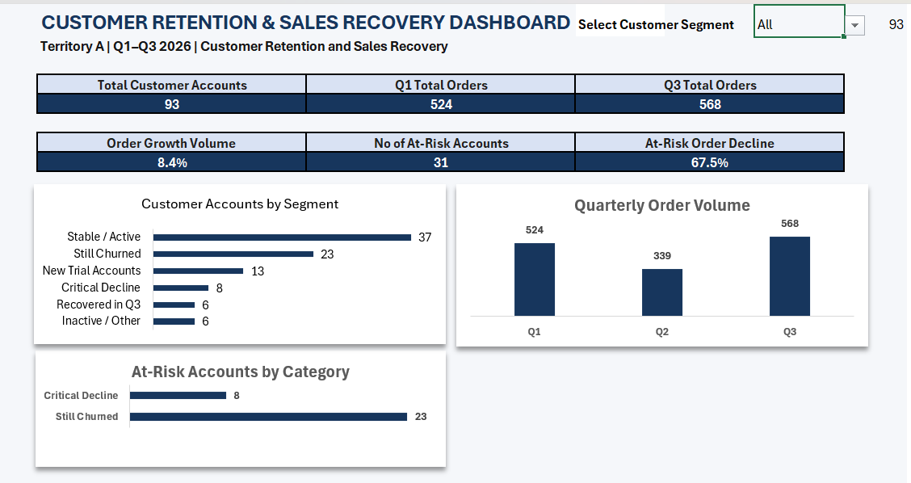

# StrideWear Footwear: Customer Retention & Sales Recovery Analysis

## Project Overview

This project analyses customer ordering patterns over three quarters (Q1–Q3 2026) to identify customer inactivity, declining order volumes, and opportunities for sales recovery.

Using Microsoft Excel and Power Query, I consolidated and prepared customer order data, classified customer accounts according to their ordering behaviour, and developed an interactive dashboard to support customer retention analysis and sales recovery planning.

## Business Problem

Without a consolidated view of customer ordering behaviour, it was difficult to identify which customer relationships required attention and prioritise sales recovery efforts.

The analysis focused on three questions:

- Which previously active customers had stopped ordering?
- Which customers were experiencing significant declines in order volume?
- Where should sales follow-up and recovery efforts be prioritised?

## Tools Used

- **Microsoft Excel:** Formulas, PivotTables, filters, SUBTOTAL, and dashboard development.
- **Power Query:** Data cleaning, appending order extracts, merging datasets, and customer account consolidation.

## Dashboard Preview

The interactive dashboard presents customer segmentation, quarterly order volume, and accounts requiring sales recovery attention.

## Key Findings

The analysis covered **93 unique parent customer accounts** within the defined customer portfolio.

| Metric | Finding |
|---|---:|
| Customer accounts analysed | 93 |
| Q1 total orders | 524 |
| Q3 total orders | 568 |
| Q1–Q3 order-volume growth | 8.4% |
| At-risk accounts | 31 |
| Order-volume decline among at-risk accounts | 67.5% |

### Customer Segmentation

The 93 accounts were classified into six groups:

| Customer Segment | Accounts |
|---|---:|
| Stable / Active | 37 |
| Still Churned | 23 |
| Critical Decline | 8 |
| New Trial Accounts | 13 |
| Recovered in Q3 | 6 |
| Inactive / Other | 6 |
| **Total** | **93** |

Although overall order volume increased by 8.4% between Q1 and Q3, the 31 accounts classified as Still Churned or Critical Decline experienced a combined order-volume decline of 67.5%.

This demonstrates why overall order performance should be examined alongside customer-level activity.

## Recommendations

Based on the findings, I proposed a targeted Q4 recovery plan focused on:

- Re-engaging previously active customers who had stopped ordering.
- Investigating significant declines in customer order volume.
- Encouraging repeat purchases from new trial accounts.
- Resolving internal issues identified during customer follow-up.
- Monitoring customer activity and measuring the effectiveness of recovery actions.

The transactional data identified changes in ordering behaviour but did not establish their underlying causes. Further customer engagement would be required to investigate those causes.

## Project Files

- **Dashboard:** `dashboard/customer-retention-sales-recovery-dashboard.png`
- **Excel Analysis:** `analysis/customer-retention-sales-recovery.xlsx`
- **Detailed Case Study:** `documentation/customer-retention-sales-recovery-case-study.pdf`

## Skills Demonstrated

- Data cleaning and preparation
- Data integration and customer account validation
- Exploratory data analysis
- Customer segmentation
- Quantitative analysis and validation
- Business insight development
- Data-driven recommendations and action planning

## Scope and Confidentiality

StrideWear Footwear is a simulated company identity used to present this portfolio project. The analysis is based on a real-world commercial analysis conducted in a professional sales environment.

Customer identifiers and the presentation have been anonymised to protect confidentiality. The reported figures represent the defined customer portfolio analysed and should not be interpreted as verified company-wide totals.

The Q4 recovery plan contains proposed actions and expected outcomes; actual recovery results have not been established by this analysis.
